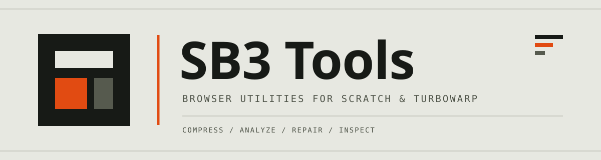

<p align="center">
  
</p>

<p align="center">
  <a href="LICENSE"></a>
  <a href="https://pixelnest256.github.io/sb3-tools/ja/"></a>
</p>

**Scratch / TurboWarp のプロジェクトをブラウザ上で扱うツール集です。** `.sb3` の圧縮、構造の分析、破損データの修復、SB3 Tools の透かし確認ができます。アプリのインストールや、ローカルファイルのサーバーへのアップロードは不要です。

[ウェブサイトを開く](https://pixelnest256.github.io/sb3-tools/ja/) · [English](README.md) · [MIT License](LICENSE)

> ローカルのプロジェクトはブラウザ内で処理します。透かしチェッカーは公開 Scratch プロジェクトの ID / URL にも対応しており、この機能では公開プロキシ経由で Scratch からデータを取得します。

## ツール一覧

| ツール | 機能 | 開く |
| --- | --- | --- |
| **Project Compressor** | `project.json` を最適化します。Scratch 互換の構造を保ち、メディアはそのままコピーします。 | [開く](https://pixelnest256.github.io/sb3-tools/sb3/ja/) |
| **Media Compressor** | PNG・JPEG・SVG・WAV・MP3 のコスチュームや音声を最適化します。 | [開く](https://pixelnest256.github.io/sb3-tools/media/ja/) |
| **Full Compressor** | プロジェクトデータとメディアの圧縮をまとめて実行します。 | [開く](https://pixelnest256.github.io/sb3-tools/full/ja/) |
| **Analyzer** | プロジェクト JSON のサイズ、メディア、アセット、ブロック数を分析します。プロジェクトは変更しません。 | [開く](https://pixelnest256.github.io/sb3-tools/analyzer/ja/) |
| **Repair** | 破損した SB3、JSON、ブロック参照、ストア、アセット情報などを検証し、可能な範囲で修復します。 | [開く](https://pixelnest256.github.io/sb3-tools/repair/ja/) |
| **Watermark Checker** | ローカルまたは公開 Scratch プロジェクトの SVG コスチュームから透かし情報を読み取ります。 | [開く](https://pixelnest256.github.io/sb3-tools/watermark/ja/) |

各ツールには英語ページと日本語ページ（`/ja/`）があります。サイトは静的ファイルで構成されており、実行時のビルドは不要です。

## どの圧縮ツールを使う？

- **Project Compressor** — プロジェクトデータを小さくしたい場合。画像・音声のデータには手を加えません。
- **Media Compressor** — 容量の多くをコスチュームや音声が占めている場合。
- **Full Compressor** — プロジェクトデータとメディアの両方を処理したい場合。

### プロジェクトデータの最適化

ブロック ID やストア ID の短縮、未使用データや既定値の削除、コードの整理、定数式の畳み込み、`project.json` の最小化などを行います。最終圧縮では、Scratch 3 のコアメニューシャドウと Pen 拡張の色パラメータメニューのうち、Scratch VM で実行結果の同一性を確認した種類を削除します。文字列値のメニューは標準テキストプリミティブ `[10, 値]` に、`event_broadcast_menu` は VM 固有の `[11, メッセージ名, メッセージID]` に変換します。対応するメニュー opcode は明示的に許可リスト化し、実行時同等性テストで保護しています。未知のメニュー、未検証の拡張メニュー、参照構造が安全でないメニューは変更しません。控えめな整理から **最大** までのプリセットに加え、個別のオプションも選択できます。

既定ではモニターを保持します。コードの構造や保存データを変更する処理もあるため、各オプションの説明を確認し、出力を Scratch または TurboWarp でテストしてください。影響の大きい処理は通常のプリセットと分けています。

### メディアの最適化

| 形式 | 処理 |
| --- | --- |
| PNG | パレット減色（非可逆・ディザリング任意）、無劣化の OxiPNG 最適化、または元のまま。透過は保持します。 |
| JPEG | 指定品質で MozJPEG により再エンコードします。ピクセル寸法は保持します。 |
| SVG | SVGO による最適化。パレットモードでは PNG への変換も選択できます。 |
| WAV | リサンプリング、任意のモノラル化、または MP3 への変換。 |
| MP3 | ID3 タグの除去、または低いビットレートでの再エンコード。 |

新しいデータが実際に小さくなる場合だけアセットを置き換えます。形式変換では `project.json` 内のアセット情報も更新します。パレット PNG は非可逆圧縮です。元のプロジェクトは必ず別に保管してください。

### SVG の透かし

3つの圧縮ツールは、出力に残る参照済み SVG コスチュームに、表示されない小さな透かしを追加します。透かしには圧縮日時（UTC）、元のプロジェクトファイル名、ツールのバージョン、関連オプションが記録されます。SVG の `<desc>` 要素に格納されるため、見た目には影響しません。

Watermark Checker は、透かしあり・なし・不正・混在を報告します。プロジェクト自体は変更しません。Scratch プロジェクトの URL / ID で検査できるのは、公開状態で取得可能なプロジェクトに限られます。

## Scratch の容量制限

Analyzer は、Scratch へのアップロード時に関係する次の上限を表示します。

- `project.json`：**5 MB**
- 個別のメディアアセット：**10 MB**

これらは確認のための警告基準です。上限内であることが、正常動作を保証するわけではありません。

## ローカルで実行する

ウェブサイトのプレビューに依存関係のインストールは不要です。リポジトリのルートで実行します。

```sh
python -m http.server 8000 --directory docs
```

その後、<http://localhost:8000/> を開きます。HTTP で配信すると Web Worker が利用でき、圧縮中もページの応答性を保てます。`file://` で直接開いた場合、メインスレッドで処理するモードに切り替わることがあります。

## 開発者向け情報

### リポジトリ構成

```text
docs/                   静的サイトとブラウザツール
├── index.html          英語のトップページ
├── ja/index.html       日本語のトップページ
├── sb3/                Project Compressor
├── media/              Media Compressor と同梱コーデック
├── full/               Full Compressor と同梱コーデック
├── analyzer/           Analyzer
├── repair/             Repair
├── watermark/          Watermark Checker
└── watermark.js        共有の透かしエンコーダー／デコーダー
build/
├── media/              コーデックのビルドスクリプトと依存関係
└── check/              回帰テスト・不変条件チェック
README.md               英語ドキュメント
README.ja.md            日本語ドキュメント
LICENSE                 MIT License
```

サイト本体は HTML・CSS・JavaScript の静的ファイルです。ビルド済みコーデックは `docs/media/vendor/` と `docs/full/vendor/` に含まれているため、通常のチェックアウトでは再生成する必要はありません。

### 同梱コーデックの再生成

メディアコーデックの依存関係を更新するときだけ実行します。

```sh
cd build/media
npm install
node build.mjs
```

Media Compressor と Full Compressor 用のブラウザバンドルと WASM ファイルを生成します。`npm install` にはネットワーク接続が必要です。

### 回帰テスト

各チェックは独立した Node スクリプトです。ルートでの `npm install` は必要ありません。圧縮・修復・透かし処理を変更したときは、関連するチェックを実行してください。

```sh
node build/check/compress-invariants.mjs
node build/check/media-invariants.mjs
node build/check/option-tooltip-invariants.mjs
node build/check/preset-invariants.mjs
node build/check/repair-invariants.mjs
node build/check/watermark-invariants.mjs
node build/check/goboscript-rules.mjs
```

`goboscript-rules.mjs` は、第1引数または `GOBOSCRIPT_SB3` に実在する `.sb3` のパスを指定すると、実プロジェクトを使ったテストも実行します。指定がない場合は合成データでテストします。

Scratch VM による任意の実行比較には、別ディレクトリへの `@scratch/scratch-vm` のインストールが必要です。

```sh
npm install --prefix /tmp/sb3-tools-runtime @scratch/scratch-vm
NODE_PATH=/tmp/sb3-tools-runtime/node_modules node build/check/goboscript-runtime.mjs
```

実プロジェクトは `GOBOSCRIPT_SB3` または第1引数で指定できます。この比較は選択されたケースの回帰テストであり、すべてのプロジェクト・実行経路での同等性を証明するものではありません。

## 注意事項

- 圧縮・修復の前に、元の `.sb3` のコピーを保管してください。処理は元に戻せません。
- パレット PNG への変換は非可逆です。画素を変えたくない場合は無劣化の OxiPNG、または元のままを選んでください。
- SVG から PNG への変換では、ベクター画像が指定ピクセルサイズのラスター画像になります。
- Repair は一部の ZIP / JSON 構造を復元できますが、途中で切れたファイルから失われたデータは復元できません。
- 圧縮・修復後のプロジェクトは、共有する前に Scratch または TurboWarp で動作確認してください。

## ライセンス

SB3 Tools は [MIT License](LICENSE) のもとで配布しています。サードパーティ製コーデックのライセンス表記は `docs/media/vendor/LICENSE.md` を参照してください。
