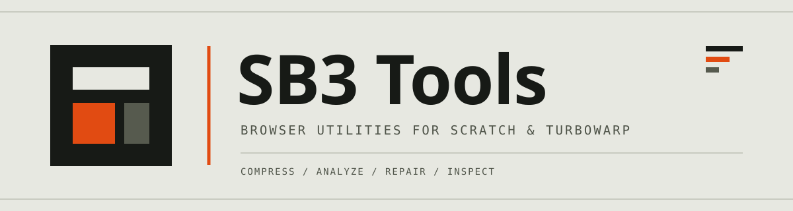

<p align="center">
  
</p>

<p align="center">
  <a href="LICENSE"></a>
  <a href="https://pixelnest256.github.io/sb3-tools/"></a>
</p>

**Browser-based tools for Scratch and TurboWarp projects.** Compress `.sb3` files, inspect project structure, recover damaged archives, and check SB3 Tools watermarks — without installing an application or uploading local files to a server.

[Open the website](https://pixelnest256.github.io/sb3-tools/) · [日本語](README.ja.md) · [MIT License](LICENSE)

> Local projects are processed in your browser. The Watermark Checker can also inspect public Scratch projects by ID or URL; that feature retrieves public project data through a public proxy.

## Tools

| Tool | What it does | Open |
| --- | --- | --- |
| **Project Compressor** | Optimizes `project.json` while preserving Scratch-compatible structure. Media files are copied unchanged. | [Open](https://pixelnest256.github.io/sb3-tools/sb3/) |
| **Media Compressor** | Optimizes costumes and sounds: PNG, JPEG, SVG, WAV, and MP3. | [Open](https://pixelnest256.github.io/sb3-tools/media/) |
| **Full Compressor** | Combines project-data and media compression in one workflow. | [Open](https://pixelnest256.github.io/sb3-tools/full/) |
| **Analyzer** | Reports project JSON size, media usage, assets, and block counts. Does not modify the project. | [Open](https://pixelnest256.github.io/sb3-tools/analyzer/) |
| **Repair** | Validates and attempts to recover damaged SB3 archives, project JSON, block references, stores, and asset metadata. | [Open](https://pixelnest256.github.io/sb3-tools/repair/) |
| **Watermark Checker** | Reads watermark metadata from SVG costumes in a local project or a public Scratch project. | [Open](https://pixelnest256.github.io/sb3-tools/watermark/) |

Every tool has English and Japanese pages; Japanese pages are under `/ja/`. The site is static and requires no build step to run.

## Choosing a compressor

- **Project Compressor** — when project data is the main source of unnecessary size and media should remain untouched.
- **Media Compressor** — when costumes or sounds account for most of the file size.
- **Full Compressor** — when both passes are needed.

### Project-data optimization

The project pass can shorten block and store IDs, remove unused data and default values, simplify code, fold constant expressions, and minify `project.json`. The final-pass compressor removes tested Scratch 3 core menu shadows and the Pen extension's color-parameter menu: string-valued menus become standard text primitives `[10, value]`, while `event_broadcast_menu` uses the VM-native `[11, message name, message ID]` encoding. The supported menu opcodes are explicitly allowlisted and guarded by Scratch VM runtime-equivalence tests; unrecognized, extension-specific, or structurally unsafe menu shadows are preserved. Presets range from conservative cleanup to **Maximum**, with individual options also available.

Monitors are preserved by default. Some transformations restructure scripts or alter stored data. Review each option and test the output in Scratch or TurboWarp; higher-impact transformations are separated from standard presets.

### Media optimization

| Format | Processing |
| --- | --- |
| PNG | Palette reduction (lossy, optional dithering), lossless OxiPNG optimization, or keep original. Transparency is preserved. |
| JPEG | MozJPEG re-encoding at a selected quality; pixel dimensions are preserved. |
| SVG | SVGO optimization; optional rasterization to palette PNG in Palette mode. |
| WAV | Resampling, optional mono downmix, or conversion to MP3. |
| MP3 | ID3 tag removal or re-encoding at a lower bitrate. |

An asset is replaced only when the output is smaller. Format conversions update the related asset metadata in `project.json`. Palette PNG compression is lossy, so keep an untouched copy of the original project.

### SVG watermarks

All three compressors add a small, non-rendering watermark to referenced SVG costumes in the output. It records the compression time (UTC), original project filename, tool version, and relevant option flags. The watermark is stored in an SVG `<desc>` element and does not add visible artwork.

The Watermark Checker reports marked, unmarked, invalid, or mixed watermark data without modifying the project. Public Scratch lookup is limited to projects that can be accessed publicly.

## Scratch project limits

The Analyzer highlights two commonly relevant upload limits:

- `project.json`: **5 MB**
- Individual media asset: **10 MB**

These are warnings for review, not a guarantee that every project within the limits will behave as expected.

## Run locally

No dependency installation is needed to preview the site. From the repository root:

```sh
python -m http.server 8000 --directory docs
```

Open <http://localhost:8000/>. Serving over HTTP is recommended so the tools can use Web Workers and keep the page responsive. Opening pages through `file://` may cause processing to fall back to the main browser thread.

## Development

### Repository layout

```text
docs/                   Static website and browser tools
├── index.html          English landing page
├── ja/index.html       Japanese landing page
├── sb3/                Project Compressor
├── media/              Media Compressor and vendored codecs
├── full/               Full Compressor and vendored codecs
├── analyzer/           Analyzer
├── repair/             Repair
├── watermark/          Watermark Checker
└── watermark.js        Shared watermark encoder/decoder
build/
├── media/              Codec build script and dependencies
└── check/              Regression and invariant checks
README.md               English documentation
README.ja.md            Japanese documentation
LICENSE                 MIT License
```

The site is plain static HTML, CSS, and JavaScript. Prebuilt browser codec bundles are committed under `docs/media/vendor/` and `docs/full/vendor/`; a normal checkout does not need to rebuild them.

### Rebuild vendored codecs

Only needed when updating media codec dependencies:

```sh
cd build/media
npm install
node build.mjs
```

This generates the browser bundles and WASM files used by the Media and Full Compressors. `npm install` requires network access.

### Regression checks

These are standalone Node scripts; no root-level package installation is required. Run relevant checks after changing the compressor, repair engine, or watermark implementation:

```sh
node build/check/compress-invariants.mjs
node build/check/media-invariants.mjs
node build/check/option-tooltip-invariants.mjs
node build/check/preset-invariants.mjs
node build/check/repair-invariants.mjs
node build/check/watermark-invariants.mjs
node build/check/goboscript-rules.mjs
```

`goboscript-rules.mjs` accepts a real `.sb3` fixture as its first argument or through `GOBOSCRIPT_SB3`. Without a fixture, it runs synthetic cases.

The optional Scratch VM runtime comparison requires `@scratch/scratch-vm` in a separate directory:

```sh
npm install --prefix /tmp/sb3-tools-runtime @scratch/scratch-vm
NODE_PATH=/tmp/sb3-tools-runtime/node_modules node build/check/goboscript-runtime.mjs
```

A real project can be supplied through `GOBOSCRIPT_SB3` or as the first argument. These bounded comparisons cover selected cases; they are regression tests, not proof of equivalence for every project or execution path.

## Important notes

- Keep a backup of the original `.sb3` before compression or repair. These operations are not reversible.
- Palette PNG conversion is lossy. Use lossless OxiPNG or keep the original when pixel values must not change.
- SVG-to-PNG conversion turns vector artwork into a raster image at its selected pixel size.
- Repair can reconstruct some damaged ZIP and JSON structures, but cannot recover data missing from a truncated file.
- Test compressed or repaired projects in Scratch or TurboWarp before sharing them.

## License

SB3 Tools is distributed under the [MIT License](LICENSE). See `docs/media/vendor/LICENSE.md` for third-party codec notices.
